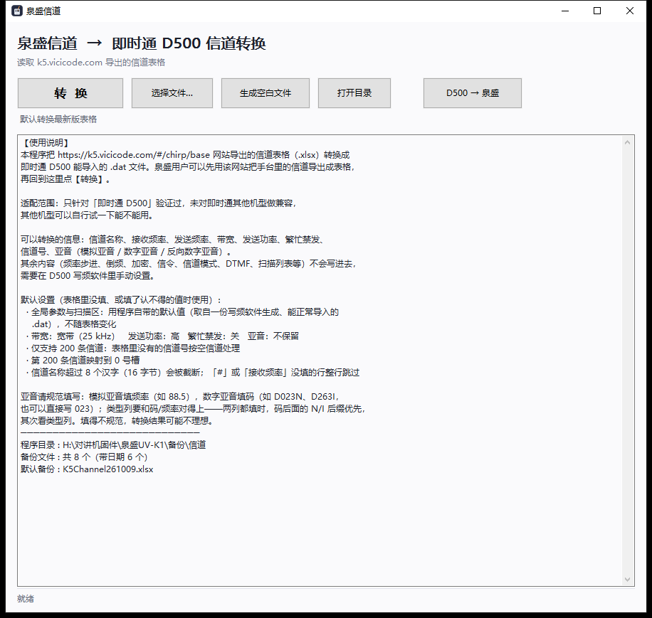
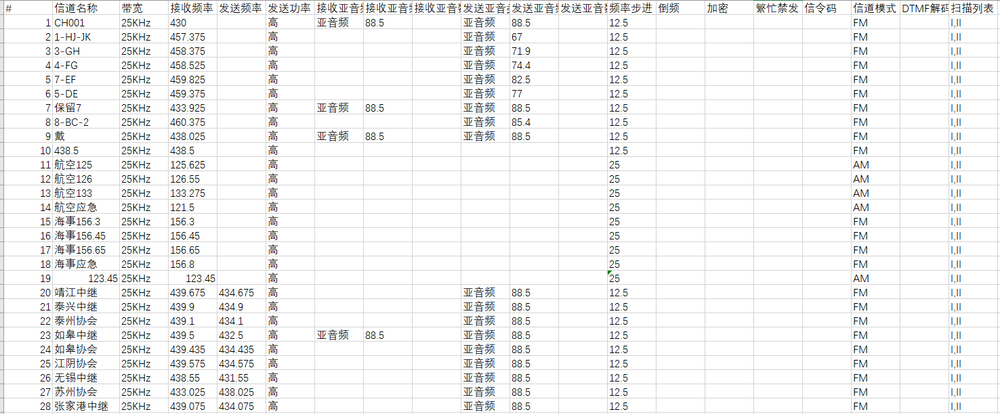
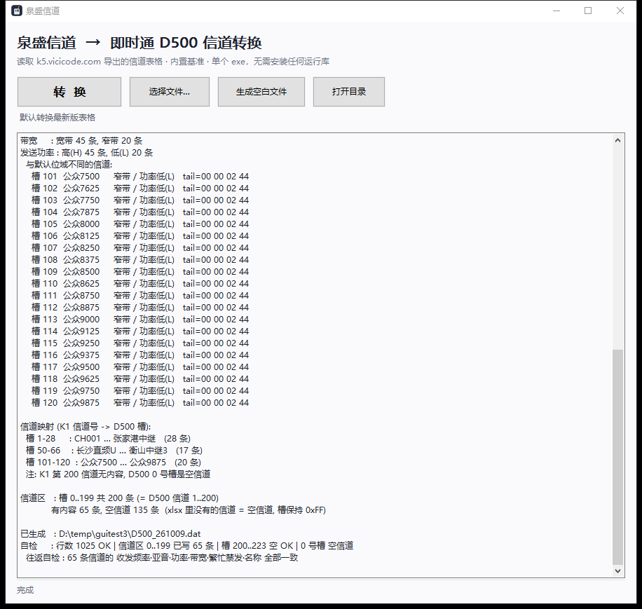
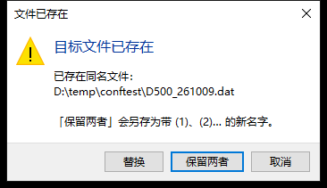
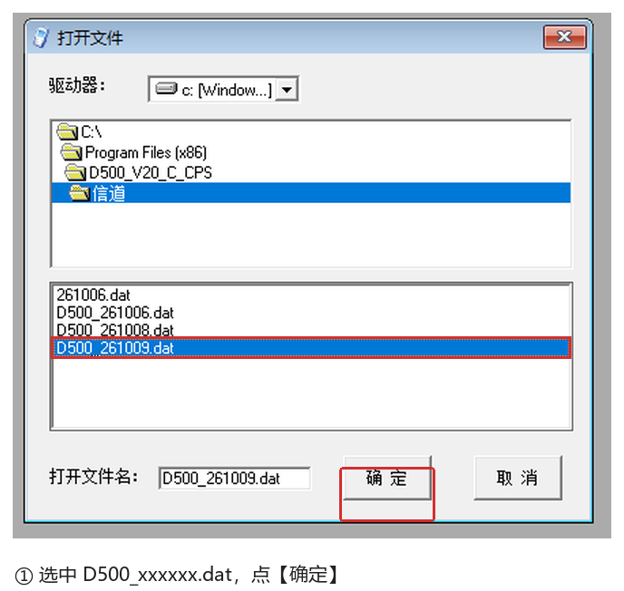
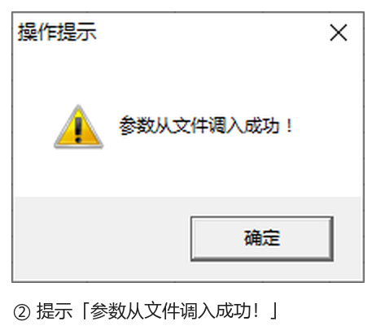
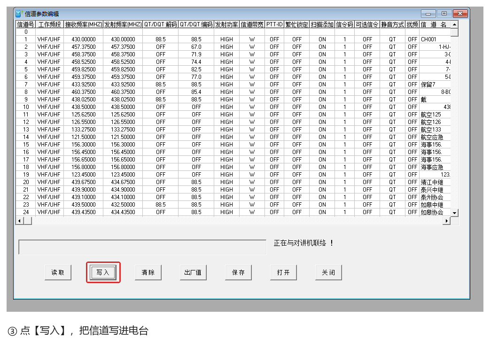
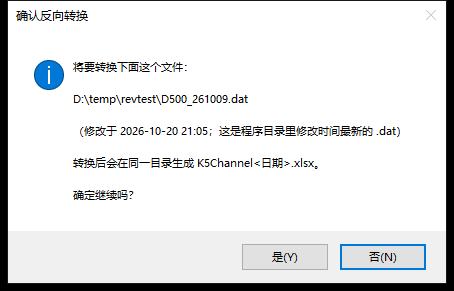
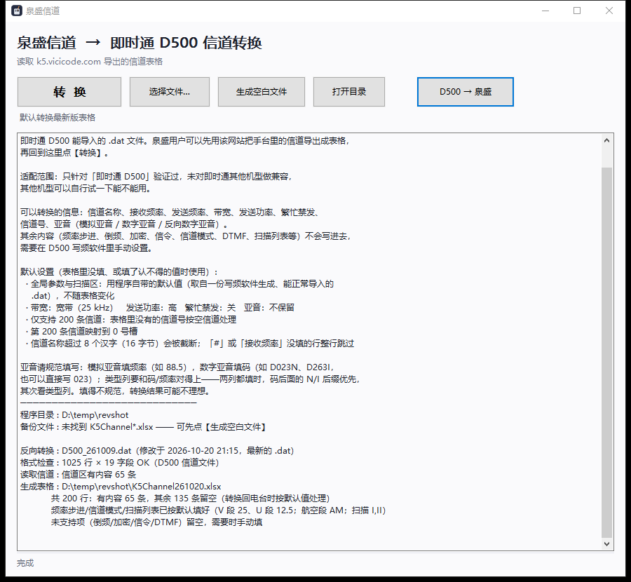

# 信道表格 ⇄ 即时通 D500 写频文件转换器（C++ 版）

> **本项目的全部代码与文档均由 AI 编写**：使用 **DeepSeek Harness** 完成，人工只负责提需求、在真实电台上验证和验收。

> **适配范围：仅适配即时通 D500。** 即时通的其他机型未做测试；
> 感兴趣的可以自行测试，风险自负。
>
> 本程序把表格转换成即时通 D500 写频文件；有泉盛设备时可以直接导出信道，无需手动填写。
> 表格可以来自网站导出，也可以自己填空白表格，详见[「1. 准备信道表格」](#1-准备信道表格xlsx)。
>
> 泉盛侧的支持范围与 k5.vicicode.com 一致：那个网站支持导出哪些泉盛型号的信道，本工具就支持哪些。

把 [k5.vicicode.com](https://k5.vicicode.com/#/chirp/base) 导出的信道表格（`.xlsx`）转换成
**即时通 D500** 写频软件能直接打开的 `.dat`；也能把 D500 的 `.dat` 反向转回信道表格。

**单个 exe，零依赖**：不用装 Python、不用装 Office/WPS、不用装 VC++ 运行库，双击就能用
（静态链接 CRT，只依赖 Windows 自带的 6 个系统 DLL）。

> 转换本身不需要 Office/WPS —— xlsx 的读写是程序内置实现的。
> 但如果你想**手工编辑**表格内容（填空、改信道名、改频率），还是得用
> Excel / WPS / k5.vicicode.com 网站；本程序只负责读和转换。



---

## 它解决什么问题

即时通 D500 的写频软件架构过于老旧，编辑起来也麻烦：
改信道名、改频率、改亚音，都要在软件里一格一格地填；信道一多，逐条编辑非常费劲。
而且它只认自己的 `.dat`，没法直接把网页或 Excel 里整理好的信道表拿进来。

本工具把「编辑信道」这一步挪到更好用的地方：

1. 在 [k5.vicicode.com](https://k5.vicicode.com/#/chirp/base) 或 Excel / WPS 里批量整理信道；
2. 用本工具一键转换成 D500 写频软件能直接打开的 `.dat`；
3. 写频软件只需要【打开】→【写入】，**常用信道参数不用再在软件里逐条编辑**。

```
原来的做法：
  D500 写频软件里逐格填 → 写入电台

用本工具：
  网页/Excel 批量编辑 → K1toD500 转换 → 写频软件【打开】→【写入】电台
```

两种格式的信道号、频率、亚音、功率、带宽编码方式不同，但这些都由程序内部处理，
你只需要准备一份表格。

写频软件仍然要用 —— 它负责最后把 `.dat` 写进电台；本工具只是把「编辑」这一步从写频软件里解放出来。
少数本工具不转换的参数（频率步进、倒频、加密、信令码、信道模式、DTMF、扫描列表）
在不同设备/固件上的设置不一致，无法直接映射，仍需在写频软件里设置。

转换完成后，**不要双击 `.dat`**（Windows 不知道拿它怎么办），
要在 D500 写频软件里用【打开】把它调进去，再点【写入】写进电台。

> **先分清两个方向：**
> - **正向（主功能，你要用的）**：信道表格 `.xlsx` → `D500_<日期>.dat` → 写频软件【打开】→【写入】电台。
> - **反向（可选，文末）**：D500 的 `.dat` → `K5Channel` 信道表格 `.xlsx`，用于把电台里的信道导回表格。
>
> 转换后的导入步骤见[「3. 转换后：导入 D500 写频软件并使用」](#3-转换后导入-d500-写频软件并使用)。

---

## 功能一览

| 功能 | 说明 |
| --- | --- |
| 适配机型 | 输出仅即时通 D500；即时通其他机型未测试 |
| 输入方式 | 直接使用网站导出的表格，或自填空白表格 |
| 泉盛型号 | 与 k5.vicicode.com 支持导出的型号一致 |
| 正向转换 | 信道表格 `.xlsx` → D500 写频软件 `.dat`（主功能） |
| 反向转换 | D500 的 `.dat` → `K5Channel` 信道表格 `.xlsx`（次要功能，见[反向转换](#反向转换)） |
| 生成空白表 | 写出一份空的 `K5Channel<今天>.xlsx`，拿去填信道 |
| 重名保护 | 目标文件已存在时弹窗三选一：替换 / 保留两者 / 取消 |
| 自检 | 写盘后回读并独立解码，逐项比对频率、亚音、功率、带宽、繁忙禁发、名称 |
| 拖放 | 把 xlsx 拖进窗口，或拖到 exe 图标上，等同【选择文件…】 |

---

## 下载与运行

1. 打开 [Releases](https://github.com/Liuli-Lumine/K1toD500/releases/latest)，下载 **`K1toD500.exe`**。
2. 把它放到一个**有写权限**的目录，例如 `D:\电台\信道`。
   **不要**放 `C:\Program Files` 这类需要管理员权限的目录 —— 程序会把生成的 `.dat` 写在 exe 旁边。
3. 双击运行。程序启动后会在下方显示完整的使用说明。

系统要求：Windows 10 / 11（64 位）实测可用；不需要 Python、Office、WPS、VC++ 运行库。
exe 没有代码签名，首次运行如果被 SmartScreen 拦下，点「更多信息 → 仍要运行」；
杀毒软件误报的处理见[常见问题](#常见问题)。

---

## 写频软件请从即时通官网下载

> ⚠️ **本工具只生成 `.dat`，不包含写频软件。** D500 的写频软件请到即时通（ZASTONE）官网下载，
> 不要用来路不明的网盘包或「绿色版」。

官方入口：

| 入口 | 地址 |
| --- | --- |
| 即时通官网（中文） | <https://www.zastone.com.cn/> |
| 即时通官网（国际） | <https://www.zastone.com/> |
| D500 写频软件下载页（2026 V2.0） | <https://h.zastone.com/download/showdownload.php?id=290> |

软件名：**D500 全频段车载电台编程软件（Ver 2.0）**。
如果上面的下载页失效，请从官网首页进入「下载中心 / 服务支持」，找 **D500** 对应的写频软件，
不要随便下别的机型的版本。

> **不要**用来路不明的网盘包、卖家群里的「绿色版 / 破解版」。
> 写频软件是直接操作电台硬件的程序，被篡改过的版本轻则写乱信道，重则把机器写砖。
> 本项目的 Release 目前只有转换器和原 Python 脚本，**没有**写频软件。

---

## 快速开始（照着做）

1. **装写频软件**：按上一节从即时通官网下载并安装 D500 写频软件。
2. **准备表格**：在 [k5.vicicode.com](https://k5.vicicode.com/#/chirp/base) 整理好信道，导出 `.xlsx`
   （文件名建议保持 `K5Channel<yymmdd>.xlsx`）。
3. **转换**：把 `K1toD500.exe` 和 xlsx 放在同一目录，双击 exe，点【转换】。
   成功后会生成 `D500_<yymmdd>.dat`。
4. **备份原机信道**：写频线连接电台，打开写频软件，【读取】→【保存】，先备份电台里现有的信道。
5. **导入**：在写频软件的「信道参数编辑」窗口点【打开】，选中刚生成的 `.dat`，
   提示「参数从文件调入成功！」。
6. **写入**：核对信道无误后点【写入】，等进度结束；再【读取】回来校验一遍。

下面把第 2～6 步拆开细说。

---

## 详细用法

### 1. 准备信道表格（.xlsx）

表格来源有两种：

**情况 A：已有泉盛设备，从 k5.vicicode.com 导出（推荐）**

已有泉盛设备时，可以在 [k5.vicicode.com](https://k5.vicicode.com/#/chirp/base) 上把设备里的信道直接导出成 xlsx，无需手动填写。

**导出的表格不用再修改，放到 exe 同目录直接【转换】即可；下面的填写说明只针对自己填空白表。**

**情况 B：自己填空白表格**

点【生成空白文件】得到 `K5Channel<今天>.xlsx`，按下面的示例填：



*图：自己填空白表的示例。前 19 条发送频率为空，就是直频；第 20 条起填了发送频率，就是带差频的中继信道。*

填写要点：

* **接收频率必填，优先把它填对**；**发送频率不填时默认等于接收频率**，也就是直频。
* **带宽**只推荐填 `25KHz` 或 `12.5KHz`；**发送功率**只推荐填汉字 `高` / `中` / `低`。
* **繁忙禁发**：填 `开` 为开；**不填默认为关**。

**哪些项目不会被转换：**

| 会转换 | 不会转换（需要在 D500 写频软件里设置） |
| --- | --- |
| 信道号、信道名、带宽、接收频率、发送频率、发送功率、繁忙禁发、接收/发送亚音 | 频率步进、倒频、加密、信令码、信道模式（FM/AM）、DTMF、扫描列表 |

> 这些项目在不同设备、不同固件上的定义和取值范围不一致，无法直接映射，所以本工具不转换。
> 网站导出的表里即使有这些列，也会被忽略；不用手动删，直接转换即可。

表格本身还有几点：

* **不要改表头和列顺序**。程序会硬校验表头（`#`、`信道名`、`带宽`、`接收频率`、`发送频率`、
  `功率`、`接收类型`、`接收HZ`、`接收数码`、`发送类型`、`发送HZ`、`发送数码`、`繁忙` 等列）。
* 工作表名保持默认的 **`Sheet1`**。
* 只认 `.xlsx`；`.xls` 请先在 Excel/WPS 里另存为 `.xlsx`。

### 2. 转换成 .dat

把 `K1toD500.exe` 放在 xlsx 所在目录，双击打开：



| 操作 | 结果 |
| --- | --- |
| 直接点【转 换】 | 自动挑 `K5Channel<yymmdd>.xlsx` 里**日期最新**的一份，生成 `D500_<yymmdd>.dat` 到 **exe 所在目录** |
| 先点【选择文件…】 | 手动指定某一份 xlsx；按钮下方的小字会变成「将要转换 &lt;文件名&gt;」 |
| 点那行小字 | 恢复成「默认转换最新版表格」 |
| 把 xlsx 拖进窗口 | 等同【选择文件…】 |
| 把 xlsx 拖到 exe 图标上 | 启动即选中该文件 |

转换成功的日志会列出：读取了多少条、带宽/功率统计、信道映射、自检结论
（行数、信道区、往返比对）。如果目标 `.dat` 已存在，会弹窗让你选：



* **替换**：覆盖同名文件。
* **保留两者**：另存为 `名字 (1).dat`，再冲突就 `(2)`、`(3)`……
* **取消**：不写文件。

默认焦点在「保留两者」，误按回车不会覆盖旧文件。

> 输出文件名里的 `yymmdd` 是「年月日」各两位，例如 `D500_261009.dat` 表示 2026-10-09。
> 这个文件名只是方便你自己认；导入时选中你刚生成的那份就行。

### 3. 转换后：导入 D500 写频软件并使用

这一节只讲**正向**：泉盛信道表格 → `D500_<日期>.dat` → D500 写频软件 → 电台。
不是反向转换；反向转换在文末，属于次要功能。

**一句话：写频软件【打开】`D500_<日期>.dat` → 核对 →【写入】。** 下面是详细步骤。

#### 3.1 先连电台、备份原信道

1. 用写频线把 D500 和电脑连起来，**电台开机**。
2. 打开 D500 写频软件，进入「**信道参数编辑**」窗口。
3. 看软件最下方的状态栏：显示「**联机故障！**」说明还没连上（见下图）；
   正常联机后这里会显示机型/固件等信息。


4. 联机正常后，先点【**读取**】，把电台里现有的信道读出来。
5. 点【**保存**】，存成 `D500_backup_<日期>.dat`。
   这就是你的**后悔药**：万一写错，用【打开】选这份备份，再【写入】就能恢复。

> 如果忘了备份：只要还没把错误内容【写入】电台，随时可以【读取】当前信道，先【保存】一份再动手。
> 养成「先读、先存、再写」的习惯最稳。

#### 3.2 用【打开】调入转换好的 .dat

在「信道参数编辑」窗口底部点【**打开**】：



在弹出的「打开文件」对话框里：

1. 找到 `K1toD500.exe` 所在目录（也就是生成 `.dat` 的地方）。
2. 在文件列表里选中 `D500_<yymmdd>.dat`。
3. 点【确定】。

成功后会弹窗：



看到「**参数从文件调入成功！**」就说明表格已经进到写频软件里了。

> 如果对话框默认停在写频软件的安装目录（例如 `C:\Program Files (x86)\D500_V2.0_CPS`），
> 用「驱动器」和文件夹列表切到你放 `.dat` 的目录即可。放桌面、U 盘、`D:\电台\信道` 都可以。
> 如果你的版本只能在安装目录里选文件，就把 `.dat` 复制到 `...\D500_V2.0_CPS\信道` 再打开。

#### 3.3 核对信道

调入成功后，表格里会显示转换后的信道。**先别急着点【写入】**，花一分钟核对：

* **信道数量**：是不是你表格里的条数（最多 200 条）。
* **接收/发送频率**：重点看有没有差一位、差一个小数点。
* **亚音**：模拟亚音（如 `88.5`）、数字亚音（如 `D023N` / `D023I`）是否对得上。
* **功率 / 带宽**：默认是高功率、宽带 25KHz，表格里填了别的才会变。
* **信道名**：中文是否正常显示，有没有被截断。
* **繁忙禁发**：需不需要开。

发现不对，**回到 xlsx 改，重新转换，再【打开】一次**。
不要在写频软件里手工改完就写 —— 下次再转换又会被覆盖，而且容易两边不一致。

#### 3.4 点【写入】写进电台

确认无误后，点【**写入**】：



* 软件可能会再弹一次确认框，点「是 / 确定」。
* 写入时状态栏会显示「正在与对讲机联络！」之类的提示。
* **写入过程中不要拔线、不要关电台、不要按 PTT**，等进度走完。
* 不同版本的提示文字可能略有差异，以进度结束、软件提示写入完成为准。

#### 3.5 写后校验

写完后建议再点一次【**读取**】，把电台里的信道读回来，和表格对一遍；
或者重新【打开】那份 `.dat` 对照。确认无误再拔线、关机。

> 【读取】会用**电台里的内容**覆盖当前表格，这是正常的。所以顺序一定是：
> **先【打开】.dat → 再【写入】**；不要调入 `.dat` 后又点【读取】，那会把刚调进来的表格冲掉。

#### 3.6 这几个按钮别点错

| 按钮 | 数据方向 | 用途 | 注意 |
| --- | --- | --- | --- |
| **打开** | `.dat` → 软件 | 导入转换结果 | 选 `D500_<日期>.dat` |
| **读取** | 电台 → 软件 | 备份原信道、写后校验 | 会覆盖当前表格 |
| **写入** | 软件 → 电台 | 真正把信道写进电台 | 写前确认表格是对的 |
| **保存** | 软件 → `.dat` 文件 | 把当前表格存成文件 | **不会**写进电台 |
| **清除** | 清空表格 | 从头填 | 慎用，先备份 |
| **出厂值** | 恢复默认 | 恢复出厂信道 | 慎用，先备份 |

最容易混淆的是【保存】和【写入】：

* **保存** = 存到电脑上的 `.dat` 文件；
* **写入** = 写进电台。

调完 `.dat` 一定要点【写入】，只点【保存】电台里什么都不会变。

---

## 常见问题

### 状态栏一直显示「联机故障！」，点【写入】没反应

按顺序排查：

1. **电台是否开机**，写频线两端是否插紧（电台侧、电脑侧）。
2. **写频线驱动**是否装好：打开「设备管理器 → 端口（COM 和 LPT）」，看有没有带黄色感叹号的设备；
   正常应该出现一个 `COMx`。
3. 写频软件里是否选对了 **COM 口**（如果软件有端口/串口设置）。
4. 关掉可能占用串口的程序：另一个写频软件、串口助手、电台控制软件等。
5. 换一个 USB 口，或换一根**能传数据**的写频线（有些线只能充电）。
6. 确认用的是 **D500** 的写频软件，不是其他机型的。

### 【打开】时找不到 .dat，或者打开报错

* `.dat` 默认生成在 **`K1toD500.exe` 所在目录**，不是 xlsx 所在目录（两者通常在同一层）。
* 文件选择框里把类型切成「所有文件（*.*）」再看。
* 不要选 `.xlsx`，也不要把 `.xlsx` 直接改后缀成 `.dat` —— 那样写频软件打不开。
* 如果文件被杀毒软件隔离了，先从隔离区恢复，或重新转换一次。
* 还不行就重新点一次【转换】，看日志里有没有报错。

### 转换时报「没有读到任何信道」

* 你选的是【生成空白文件】写出的空表，里面还没有填信道。
* 表头被改过、列顺序变了，或者工作表名不是 `Sheet1`。
* `#`（信道号）或接收频率为空的行会被整行跳过；如果整张表都空，就会报这个错。
* 确认选的是**信道备份表**，不是随便一个 xlsx。

### 中文信道名乱码或被截断

* D500 使用 **GBK** 编码存信道名，本工具会把中文转成 GBK 再写入。
* 一个信道名最多 **16 字节**，也就是 **8 个汉字**；超长会在字符边界截断，不会出现半个汉字。
* 不要用 emoji、特殊符号或生僻字，写频软件/电台的字库不一定有。
* 如果写频软件里显示乱码，先检查是不是原表格里就已经乱码，再检查写频软件版本。

### 亚音不对 / 写进去变成「无亚音」

「接收类型 / 发送类型」列只有三种值：

| 类型 | 什么时候用 | HZ / 数码怎么填 |
| --- | --- | --- |
| 模拟亚音 | CTCSS 模拟亚音 | HZ 列填频率，如 `88.5`、`67.0`、`100.0` |
| 数字亚音 | DCS 数字亚音（**推荐，普通和反向都选它**） | 数码列填 `D023N`（普通）或 `D023I`（反向） |
| 反向数字亚音 | DCS 反向数字亚音（也可选，但不是必须） | 数码列填 `D023I` |

**推荐做法：不管普通还是反向数字亚音，类型一律选「数字亚音」。**
程序会自动识别亚音码的后缀：`N` = 普通，`I` = 反向，**后缀优先于类型列**。

| 数码列写法 | 实际结果 |
| --- | --- |
| `D023N` | 普通数字亚音 |
| `D023I` | 反向数字亚音 |

* 数字亚音请写完整形式：`D` + 三位码 + `N`/`I`（如 `D023N`、`D023I`）。
* 「接收类型 / 发送类型」要和「接收 HZ/数码、发送 HZ/数码」对得上。
* 类型和数码后缀冲突时，**以 `N`/`I` 后缀为准**，日志里会提示。
* 填了认不得的值，程序会按「不保留亚音」处理，并在日志里给警告。

### 功率 / 带宽 / 繁忙禁发不对

表格里没填、或填了认不得的值时，用下面的默认值：

| 项目 | 默认值 | 推荐填法 |
| --- | --- | --- |
| 带宽 | 宽带 25 kHz | 直接填 `25KHz` 或 `12.5KHz`（推荐只填这两种） |
| 发送功率 | 高 | 只填汉字：`高` / `中` / `低` |
| 繁忙禁发 | 关 | 只填汉字 `开`；不填就是关 |
| 亚音 | 不保留 | 见上一节 |

> 按上面的推荐写法填即可，不用记其他别名；填得越简单越不容易错。

### 第 200 信道怎么跑到最前面了？

泉盛的信道号是 **1～200**，即时通 D500 的信道号是 **0～199**。本工具这样映射，
是为了照顾泉盛用户的使用习惯：

* 泉盛 **1～199** → D500 **1～199**，原号不变；
* 泉盛 **200** → D500 **0**，所以在写频软件里看起来「跑到最前面」。

如果改成从 0 号槽开始按顺序映射，那么泉盛的信道 16 会变成 D500 的 15：
你在泉盛手台上按 `016` 能到的信道，换到 D500 却要按 `015`，每个信道号都得减 1，很容易按错。
现在的映射只让第 200 信道换了个位置，换来 1～199 全部对得上。

程序只处理 **1～200** 条；表格里超过 200 的部分不会写入。同号重复时，**以先出现的为准**。

### 能不能直接用记事本改 .dat？

不行。`.dat` 是二进制格式（1025 行 × 19 个字段，频率还是 BCD 编码），
用记事本改一个字节就可能整份文件作废。要改就改 `.xlsx`，重新【转换】。

### 杀毒软件报毒 / SmartScreen 拦截

* exe 是单文件、无代码签名，部分杀软会按启发式规则误报。
* 只从本仓库的 [Releases](https://github.com/Liuli-Lumine/K1toD500/releases/latest) 下载，
  不要用来路不明的转载包。
* 不放心可以看源码自己编译（见[自己编译](#自己编译)），或者把 exe 传到 VirusTotal 多引擎复查。
* SmartScreen 提示「未知发布者」时，点「更多信息 → 仍要运行」。

### 支持泉盛其他型号 / 即时通其他机型吗？

**本工具不要求连接泉盛设备。** 有设备时直接导出信道；没有设备时，用【生成空白文件】填表即可转换。

**泉盛侧：支持范围跟 k5.vicicode.com 一致 —— 那个网站能导出哪些泉盛型号的信道，本工具就支持哪些。**
具体支持哪些型号，以网站当前为准；只要是从网站导出的原样表格（表头、列序没改），就能转换。

**即时通侧：只对 D500 验证过。** 即时通其他机型未做测试，想试可以自测，风险自负。

### 写频软件在哪里下载？

见上面[「写频软件请从即时通官网下载」](#写频软件请从即时通官网下载)。
只认即时通（ZASTONE）官网，别下网盘「绿色版」。

---

## 反向转换

> **这不是导入写频软件的步骤。** 这一节是可选的反向功能：把 D500 的 `.dat` 转回 `K5Channel` 信道表格。
> 刚把信道表格转成 `.dat`、要导入写频软件的话，请看上面的
> [3. 转换后：导入 D500 写频软件并使用](#3-转换后导入-d500-写频软件并使用)。

把 D500 的 `.dat` 转回 `K5Channel` 信道表格（D500 → 表格）。按钮在【打开目录】右边，
间隔单独拉开，属于次要功能。点了之后：

1. **先弹窗确认**：把要转换的文件（完整路径 + 修改时间）显示出来，点「是」才继续，
   默认焦点在「否」上，避免手滑。
2. 在**程序目录**里筛出所有 `*.dat`（后缀不区分大小写，跳过 `~$` 临时文件），
   按**修改时间**取最新的那一份 —— `.dat` 是写频软件自己命名的，所以不看文件名。
3. 检查**文件头**是不是 D500 的信道文件：必须正好 **1025 行 × 19 个字段**，
   每行前三个字段是 `[bank] [offset] [linear]`，后 16 个字节在 0..255。
   对不上就报错「不是 D500 信道文件」，并说明是哪一行不符合。
4. 是的话逐条读回：频率（BCD）、收发亚音、功率、带宽、繁忙禁发、名称（GBK），
   然后以内置的空白表格做底（表头/列序/结构完全保留），只重写第 2..201 行。
5. 输出 `K5Channel<今天日期>.xlsx` 到程序目录；同名时按重名规则三选一。



反向转换跑完的日志（含默认值说明）：



生成的每一行（有内容的信道）都会补上这些默认值：

| 列 | 值 | 规则 |
| --- | --- | --- |
| 频率步进 | `25` / `12.5` | V 段（< 300 MHz）用 25，U 段用 12.5 |
| 信道模式 | `FM` / `AM` | 航空段 108–137 MHz 用 AM，其余 FM |
| 扫描列表 | `I,II` | 固定 |

倒频、加密、信令码、DTMF 目前留空，需要时手动填；信道号与槽位的对应关系和正向完全一致
（第 200 信道 ↔ 0 号信道 / 槽 0）。

反向转换的正确性是拿正向做过**闭环验证**的：
`K5Channel261009.xlsx → D500_261009.dat → K5Channel261020.xlsx →（用 Python 版正向再转一次）`
得到的 `.dat` 与原文件**逐字节相同**；另外用 openpyxl 独立打开生成的 xlsx，
表头、200 行数据、单元格类型都正常。

---

## 转换规则与默认值

### 会转换的内容

| 表格里的内容 | 写入 D500 | 说明 |
| --- | --- | --- |
| `#` 信道号 | 信道号 / 槽位 | 泉盛 1..200 → D500 0..199；1..199 原号，第 200 → 0（避免整体 -1）；同号以先出现者为准 |
| `信道名` | 名称 | GBK，最多 16 字节（8 个汉字），超长截断 |
| `接收频率` / `发送频率` | RX / TX | MHz，按 D500 的 BCD 格式编码 |
| `带宽` | 宽 / 窄 | 表格填 `25KHz` 或 `12.5KHz`；默认 25KHz（宽带） |
| `功率` | 高 / 中 / 低 | 表格只填汉字 `高` / `中` / `低`；默认高 |
| `繁忙禁发` | 开 / 关 | 表格填 `开` 为开；不填为关 |
| `接收/发送 类型 + HZ/数码` | 模拟 / 数字 / 反向数字亚音 | 类型三选一；数字亚音推荐统一选「数字亚音」，程序按 `N`/`I` 后缀自动识别普通/反向 |

> 第 200 信道映射到 0 号信道（槽 0），是为了让 1～199 的信道号和泉盛保持一致；否则泉盛按 `016` 能到的信道，
> 到了 D500 要按 `015`。详见[常见问题](#第-200-信道怎么跑到最前面了)。

### 不会转换的内容

频率步进、倒频、加密、信令码、信道模式（FM/AM）、DTMF、扫描列表等**不会**写进去。
这些项目在不同设备/固件上的定义和取值范围不一致，无法直接映射，需要在 D500 写频软件里手动设置。
全局参数和扫描区使用程序内置的默认值
（取自一份写频软件生成、能正常导入的 `.dat`），不随表格变化。

### 其它固定规则

* 信道区固定 200 条：泉盛 1..199 按原号存到 D500 1..199，第 200 存到 D500 0，其余槽保持空白。
* 表格里没有的信道号按空信道处理。
* `#` 或接收频率为空的行，整行跳过。
* 写盘后会回读并独立解码，与编码前的预期逐项比对；自检不过会明确报错，不会悄悄给你一份坏文件。

---

## 与 Python 版的一致性

规则 1:1 照搬 Python 脚本（`core.cpp` 顶部注释列了主要规则），并且做了逐字节回归：

| 备份文件 | Python 产出 | C++ 产出 | 是否逐字节相同 |
| --- | --- | --- | --- |
| K5Channel260926.xlsx | D500_260926.dat | D500_260926.dat | ✅ |
| K5Channel260927.xlsx | D500_260927.dat | D500_260927.dat | ✅ |
| K5Channel261002.xlsx | D500_261002.dat | D500_261002.dat | ✅ |
| K5Channel261006.xlsx | D500_261006.dat | D500_261006.dat | ✅ |
| K5Channel261008.xlsx | D500_261008.dat | D500_261008.dat | ✅ |
| K5Channel261009.xlsx | D500_261009.dat | D500_261009.dat | ✅ |
| K5Channel_1.xlsx | D500_&lt;当天&gt;.dat | D500_&lt;当天&gt;.dat | ✅ |
| K5Channel.xlsx（空白表） | 报错「没有读到任何信道」 | 同样报错 | ✅ |

【生成空白文件】写出的 xlsx 与内置模板**逐字节相同**。

保留下来的关键行为：表头列序硬校验、信道号 1..200 越界报错、同号重复以先出现者为准、
第 200 信道映射到槽 0、槽 200..223 恒空、写盘后独立解码做往返自检
（频率/亚音/功率/带宽/繁忙禁发/名称）。

---

## 实现要点（为什么能零依赖）

| 需要的能力 | 实现方式 | 依赖 |
| --- | --- | --- |
| 读 xlsx | 自己写的 ZIP 读取 + **裸 DEFLATE 解压**（`inflate.cpp`，RFC1951）+ SpreadsheetML 扫描 | 无（不用 zlib/libzip） |
| 写 xlsx | 以内置空白表为底，只替换 `<sheetData>`，再用 `zip.cpp` 重新打包（其余条目原样搬，新表 stored） | 无（不用 zlib/libzip） |
| 中文信道名 | `WideCharToMultiByte(936)` 转 GBK，按字符边界截断 | 系统 API |
| 界面 | 纯 Win32 控件（`gui.cpp`） | 无（不用 MFC/Qt） |
| 内置基准数据 | 9232 字节编译进资源（`IDR_BASE_BLOB`） | 无 |
| 内置空白表格 | 45 KB xlsx 编译进资源（`IDR_BLANK_XLSX`），正/反向都用它 | 无 |
| 运行库 | MSVC `/MT` 静态链接 | 无（不需要 VC++ 运行库） |

exe 的实际导入表只有 `USER32/GDI32/COMCTL32/COMDLG32/SHELL32/KERNEL32`。

---

## 目录结构

```
K1toD500/
├─ src/
│  ├─ core.h / core.cpp        正向转换（规则、映射、编码、自检）—— Python 版的直译
│  ├─ reverse.h / reverse.cpp  反向转换（挑最新 .dat、校验文件头、解码、出表格）
│  ├─ d500dat.h / d500dat.cpp  .dat 格式常量 + 读写/编解码（正反向共用）
│  ├─ xlsx.h / xlsx.cpp        xlsx 读取（共享字符串/内联字符串/单元格）
│  ├─ xlsxgen.h / xlsxgen.cpp  以内置空白表为底生成 xlsx（只换 sheetData）
│  ├─ zip.h / zip.cpp          ZIP 读（含原始字节搬运）+ ZIP 写
│  ├─ inflate.h / inflate.cpp  裸 DEFLATE 解压（自包含）
│  ├─ util.h / util.cpp        UTF-8/UTF-16/GBK、路径、文件、日期
│  ├─ gui.cpp                  Win32 界面
│  └─ res_ids.h                资源 ID
├─ res/
│  ├─ app.rc                   资源脚本（清单/图标/内置数据/版本信息）
│  ├─ app.manifest             comctl32 v6 + Per-Monitor DPI
│  └─ app.ico                  图标（由 tools/make_icon.py 生成）
├─ data/
│  ├─ base.bin                 内置基准（577 行 × 16 字节）
│  └─ K5Channel.xlsx           内置空白表格（正向模板 / 反向底板）
├─ docs/                       README 里的写频导入截图
├─ tools/
│  ├─ gen_data.py              从 Python 脚本重新导出 base.bin、复制空白表
│  ├─ make_icon.py             生成 app.ico
│  └─ cli_test.cpp             命令行测试壳（正向/--rev 反向，开发期比对用）
├─ build.bat                   一键编译
└─ README.md
```

## 自己编译

**MSVC**（推荐；本次成品即用它编译）：
打开「x64 Native Tools Command Prompt for VS 2022」，`cd` 到本目录，执行 `build.bat`。

**MinGW-w64**：把 `g++`、`windres` 放进 PATH，同样执行 `build.bat`（脚本会自动判断）。

产物：`build\K1toD500.exe`。

> 本机编译环境：MSVC 14.44（VS 2022 Build Tools）+ Windows SDK 10.0.22621，`/MT` 静态链接。

## 已知限制

* 只认 `.xlsx`；`.xls` 请先另存为 `.xlsx`。
* 工作表名默认 `Sheet1`（与 Python 版一致）。
* 空白表转换会报「没有读到任何信道」——那是给你填的模板，不是可转换的备份。
* 只对即时通 D500 验证过；其他机型请自行测试，风险自负。
* exe 无代码签名，Windows SmartScreen / 杀软可能提示。

---

## 关于本项目

- **代码、界面、资源、构建脚本、文档全部由 AI 生成**，开发环境是 **DeepSeek Harness**；
  人工只提出需求、在真机上测试并验收。
- 转换规则来自原始 Python 脚本（`k1_to_d500_reference.py`，同样由 AI 编写，
  放在 v1.0.0 Release 附件里，仅供对照）的逆向结论，C++ 版逐字节对齐了它的输出。
- 项目从 0 到 1（含 .xlsx 解析、DEFLATE 解压、ZIP 读写、Win32 界面）都没有引用第三方库。
- 本项目是**非官方工具**，与即时通（ZASTONE）、泉盛（Quansheng）官方没有隶属关系；
  文中官网链接只为方便下载写频软件。

## 许可证

[GNU General Public License v3.0](LICENSE)（GPL-3.0）。

Copyright (C) 2026 Liuli-Lumine

这是一个 **copyleft** 协议：可以自由使用、修改、再发布，但**衍生作品必须同样以 GPL-3.0 开源**，
并保留版权声明与协议文本；本程序不提供任何担保。

## 免责声明

本工具只做**本地文件格式转换**，不含任何射频发射功能。请确保你写入电台的频率、功率、
呼号等符合所在国家/地区的无线电管理规定，并只在取得相应操作资格后使用。
因违规使用造成的一切后果由使用者自行承担。
